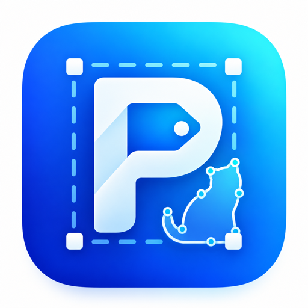
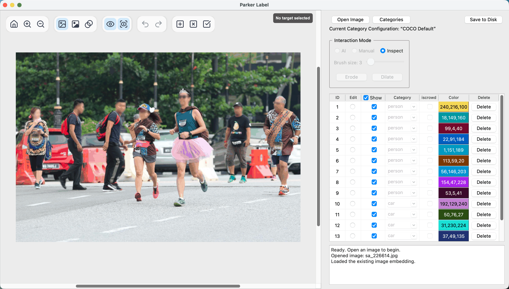
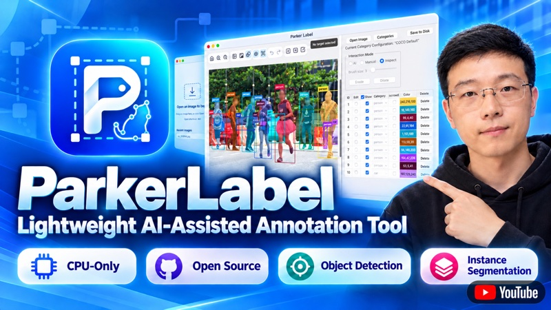
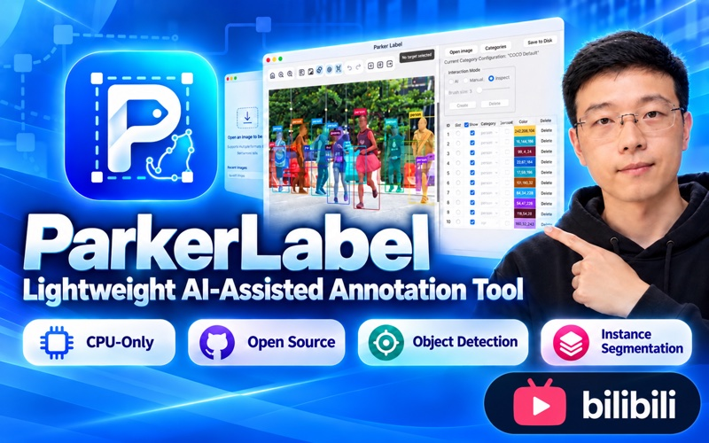
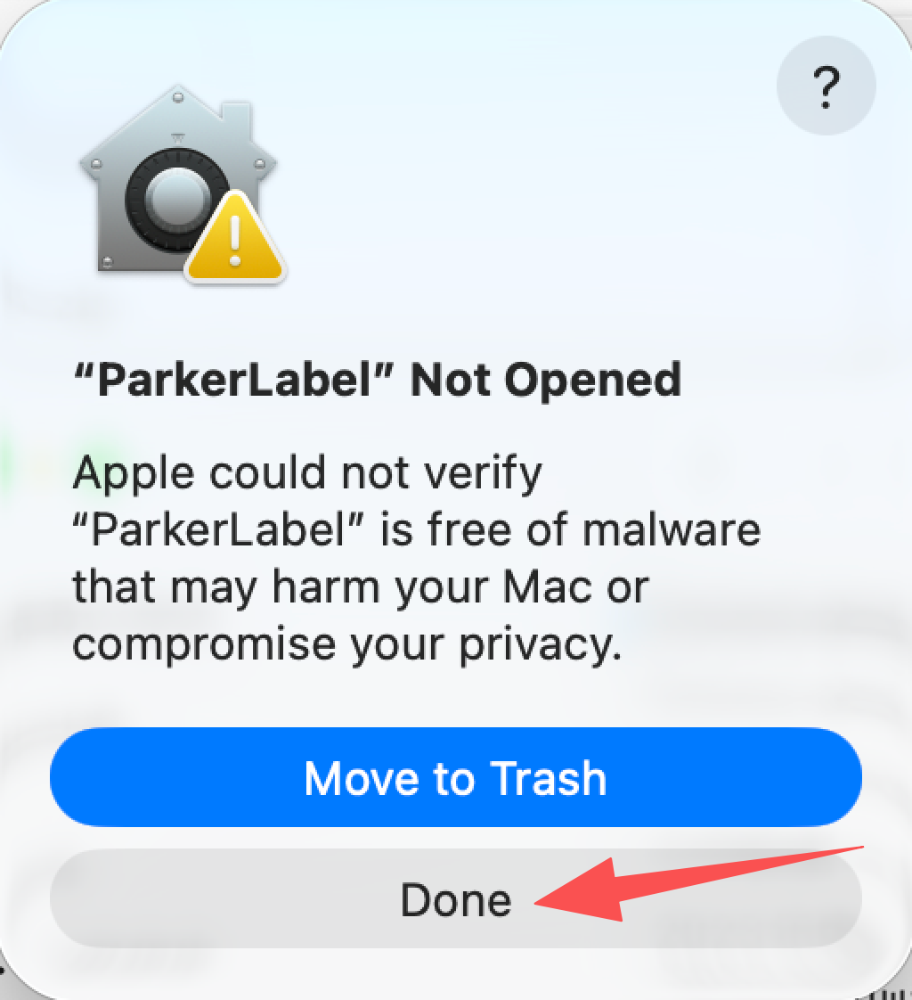
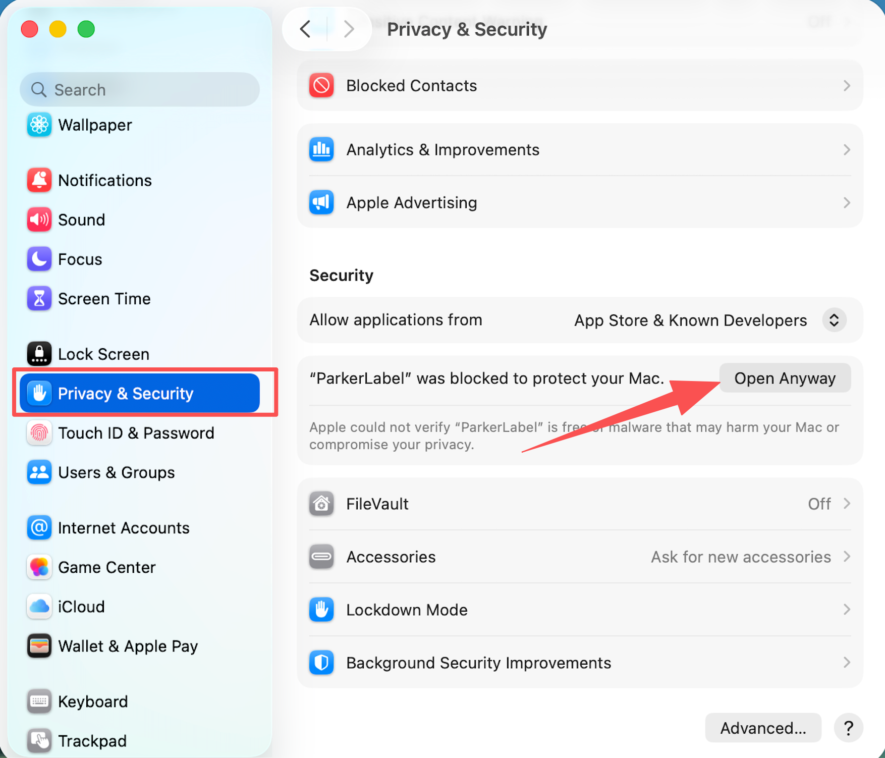
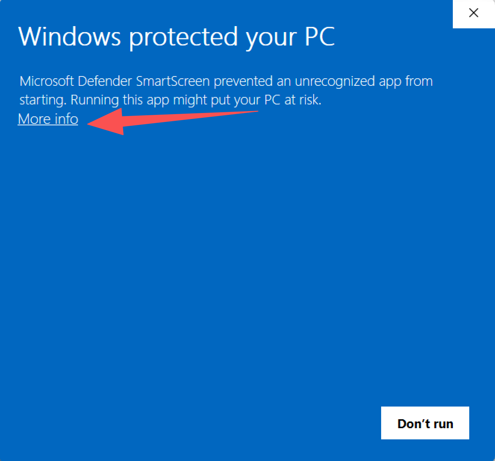
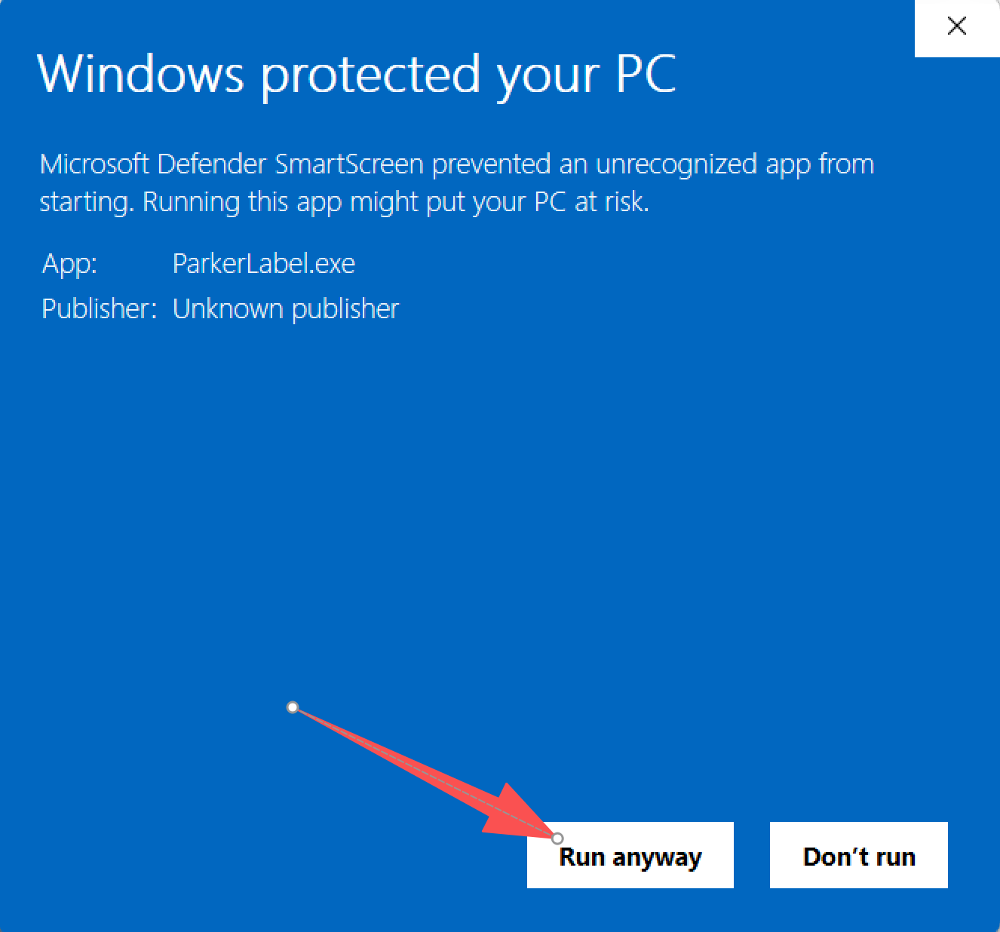

[English](../README.md) | **简体中文** | [繁體中文](README.zh-TW.md) | [日本語](README.ja.md) | [한국어](README.ko.md)

<div align="center">
  
  <h1>ParkerLabel</h1>
    <p><strong>完全使用 CPU 运行，无需 GPU。</strong></p>
  <p>一款轻量、精致的 <strong>AI 辅助</strong>交互式标注工具，适用于目标检测和实例分割。</p>
  <p>在 Apple M5 Pro 和 Intel Core i9-14900KF CPU 上，每次交互式掩码解码器推理耗时约 <strong>20 毫秒</strong>。</p>
  <p>
    <a href="https://github.com/Parker-Lyu/ParkerLabel/releases"></a>
    <a href="../builds/SOP.md"></a>
    <a href="../builds/SOP.md"></a>
    <a href="../LICENSE"></a>
  </p>
  
</div>


## 🎬 项目介绍

<p align="center">
  <a href="https://www.youtube.com/watch?v=B1eu6EKgbUI"></a>&emsp;&emsp;
  <a href="https://www.bilibili.com/video/BV1omps6dEqP"></a>
</p>

## 运行

### 使用便携版

1. 从 [GitHub Releases](https://github.com/Parker-Lyu/ParkerLabel/releases) 或[百度网盘](https://pan.baidu.com/s/1mGc8w11JHbTnERI_yztVWA?pwd=md7r)（提取码：`md7r`）下载适用于你所用平台的已发布应用包。名称为 `models-*` 的发布版本包含 ONNX 模型，不是应用包。

1. 在 macOS 和 Windows 上，打开程序前需要将解压后的整个 ParkerLabel 文件夹移动到可写入的位置。

1. macOS 包使用 ad-hoc 签名，但未经 Apple 公证，因此首次启动可能被 macOS 阻止。尝试打开应用一次后，进入**系统设置 → 隐私与安全性**，向下滚动到安全性部分，选择**仍要打开（Open Anyway）**。

1. 在 Windows 上，首次启动时 Microsoft Defender SmartScreen 可能显示 **Windows 已保护你的电脑（Windows protected your PC）**。点击**更多信息（More info）**，然后点击**仍要运行（Run anyway）**。

<p align="center">
  <a href="../docs/images/portable-macos-open-1.png"></a>
  <a href="../docs/images/portable-macos-open-2.png"></a><br>
  <a href="../docs/images/portable-windows-open-1.png"></a>
  <a href="../docs/images/portable-windows-open-2.png"></a>
</p>

仅凭这些警告不能认定 ParkerLabel 是恶意软件。便携版通过 GitHub Actions 构建；你可以查看[构建工作流](../.github/workflows/release.yml)和[构建说明](../builds/SOP.md)。

### 从源码运行

如果尚未安装 Conda 发行版，请先安装。推荐使用 [Miniforge](https://github.com/conda-forge/miniforge)，其他 Conda 发行版也可以。从 [GitHub](https://github.com/Parker-Lyu/ParkerLabel) 或 [Gitee](https://gitee.com/Parker-Lyu/ParkerLabel) 克隆项目：

```bash
git clone https://github.com/Parker-Lyu/ParkerLabel.git
```

或：

```bash
git clone https://gitee.com/Parker-Lyu/ParkerLabel.git
```

然后创建 Python 3.11 环境，安装依赖并启动 ParkerLabel：

```bash
cd ParkerLabel
conda create -n parker-label -c conda-forge python=3.11 -y
conda activate parker-label
python -m pip install -r requirements.txt
python main.py
```

ParkerLabel 会自动校验 ONNX 模型，并将缺失的模型下载到 `pretrain/`。

## 功能概览

ParkerLabel 支持中文（简体）、中文（繁體）、English、日本語、한국어、Deutsch、Français、Italiano 和 Español。通过**设置 → 界面语言 / Language**切换界面语言，通过**设置 → 操作提示**控制上下文提示。

通过**设置 → 快捷键设置…**查看、修改、清除或恢复快捷键。AI、手动和查询模式的默认快捷键分别为 `Q`、`W` 和 `E`。在 AI 模式下，正负点击引导 MobileSAM 为当前目标生成掩码。图像工具栏使用 `S` 切换叠加视图中的 AI 提示点显示，使用 `C` 切换质量检查。保存后的快捷键立即生效，并在下次启动时保留。

### 类别配置

ParkerLabel 内置包含 80 个标准 COCO 目标检测类别的只读配置。用户可以创建空白类别配置，或复制任意现有配置（包括内置 COCO 配置）来创建新版本。已保存的配置不可修改；后续修改需要将配置复制为另一个版本。用户创建的配置保存在所选的 `configs/categories/` 目录中。

每份标注通过 UUID 和 SHA-256 摘要绑定到一个类别配置。如果当前启用的是其他配置，ParkerLabel 会提示切换到所需配置。如果该配置不可用、未通过完整性校验，或用户拒绝切换，标注将以只读方式打开。

便携式设置（包括启动时选择的类别配置）保存在 `configs/settings.ini` 中。应用日志为 `configs/app.log`；每次启动时清空，运行期间最多保留两个各 1 MB 的日志文件。

### 标注文件

每张原始图像对应三个保存在同一目录的文件：

- `.npy` 保存可复用的图像嵌入。
- `.json` 保存每个实例的类别、边界框、面积，以及原始图像分辨率下的未压缩 COCO RLE。
- `.mask.png` 保存原始图像分辨率下的扁平化彩色预览。实例重叠时，后面的实例显示在上层。实例掩码以 JSON 中的数据为准。

每张图像的 JSON 使用 COCO 标注字段，但不是完整的 COCO 数据集文件。导出完整 COCO 数据集需要在一个数据集 JSON 中包含顶层 `images`、`annotations` 和 `categories` 数组。

#### JSON 字段

- `format` 标识本地标注格式，当前为 `parker-label-instance-v2`。
- `category_config_uuid` 标识与标注绑定的确切类别配置。
- `category_config_sha256` 记录该类别配置的摘要，用于检测意外更改。
- `image` 记录图像的 `id`、文件名、宽度和高度。
- `annotations` 为每个实例保存一条记录。
- `id` 是图像文件内的实例标识符。
- `image_id` 将实例关联到图像记录。
- `category_id` 引用绑定的类别配置中的一个类别。
- `category_name` 保存可读的类别名称。
- `color_id` 控制显示和预览颜色。
- `bbox` 以原始图像像素为单位保存 `[x, y, width, height]`。
- `area` 保存原始图像分辨率下的实例像素面积。
- `iscrowd` 遵循 COCO 的群体标志约定。
- `segmentation` 将独立的实例掩码保存为未压缩 COCO RLE。

## 重新生成 ONNX 模型

**依赖：**按照[适用于你所用平台的 PyTorch 安装说明](https://pytorch.org/get-started/locally/)安装 `torch` 和 `torchvision`，然后运行 `python -m pip install timm onnx onnxruntime==1.29.0`。已验证版本：torch 2.13.0、torchvision 0.28.0、timm 1.0.19、onnx 1.22.0 和 onnxruntime 1.29.0。

**检查点：**创建 `pretrain/`，然后下载官方 [MobileSAM `mobile_sam.pt`](https://github.com/ChaoningZhang/MobileSAM/blob/master/weights/mobile_sam.pt) 到 `pretrain/mobile_sam.pt`。两个导出命令只需要这一份权重，无需单独的 TinyViT 或 SAM 检查点。

**导出：**在仓库根目录运行：

```bash
python -m mobile_sam.export_mobilesam_encoder --checkpoint pretrain/mobile_sam.pt --output pretrain/encoder.onnx
python -m mobile_sam.export_mobilesam_decoder --checkpoint pretrain/mobile_sam.pt --model-type vit_t --output pretrain/decoder.onnx
```

这些命令用于开发时重新生成 ONNX 模型。ParkerLabel 启动时会根据 `model-bundle.json` 检查模型的大小和 SHA-256 哈希，并用已发布模型替换不匹配的文件。自定义导出需要匹配的模型清单。运行应用不需要 `mobile_sam.pt` 或导出依赖。`pretrain/` 中的模型文件不纳入 Git。

## 许可证

ParkerLabel 的原创代码（包括 `mobile_sam/export_mobilesam_encoder.py`）采用 [GPL-3.0-only](../LICENSE) 许可证。

`mobile_sam/` 中的第三方代码保留各自的许可证：[MobileSAM](https://github.com/ChaoningZhang/MobileSAM) 和 [Segment Anything](https://github.com/facebookresearch/segment-anything) 使用 Apache License 2.0，TinyViT 代码包含 Microsoft 的 MIT 许可声明。许可证全文和署名信息见 [`mobile_sam/LICENSE`](../mobile_sam/LICENSE)、[`mobile_sam/TINYVIT_LICENSE`](../mobile_sam/TINYVIT_LICENSE) 和 [`mobile_sam/THIRD_PARTY.md`](../mobile_sam/THIRD_PARTY.md)。

GUI 使用的 PyQt5 和 Qt 遵循各自的许可证。最终分发包的具体声明、对应源码获取说明和 Qt 替换说明维护在 [`third_party_licenses/`](../third_party_licenses/) 中。模型来源与导出溯源记录见 [`docs/model-provenance.md`](../docs/model-provenance.md)，发布审计流程见 [`docs/release-licenses.md`](../docs/release-licenses.md)。

## 致谢

ParkerLabel 的 AI 辅助分割工作流程建立在以下项目的成果之上：

- [MobileSAM](https://github.com/ChaoningZhang/MobileSAM)：面向高效推理的轻量级 Segment Anything 模型。
- [Segment Anything](https://github.com/facebookresearch/segment-anything)：由 Meta AI 开发的原始分割模型与框架。

感谢这两个项目的作者和贡献者公开分享他们的成果。
